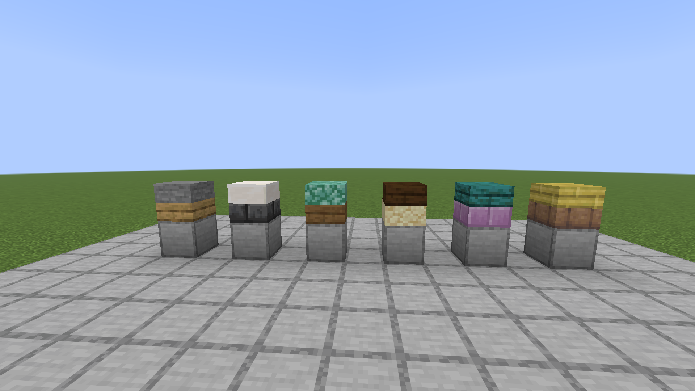

# Mixed Slabs

Two different slabs in one block space: place any slab onto any other slab's empty half and they share the block.

## Screenshots

## Placing a mixed slab

Place a slab onto the empty half of a different slab. Where vanilla would put the new slab in the next space along, this puts both in the same block. Two of the same slab still make vanilla's double slab.

Which half the new slab fills is decided the way vanilla decides it: clicking the top face fills the top of a bottom slab, the bottom face fills the bottom of a top slab, and a side click goes by whether it landed above or below the middle. Sneak to place the slab in the next space along instead.

Any vanilla slab mixes, and so do the terrain slabs from [dirt-slab](https://github.com/fatlard1993/dirt-slab) and the post slabs from [fence-posts](https://github.com/fatlard1993/fence-posts) when those are installed. A post slab leaves room around it, and water can fill that.

## Breaking one

- **Hardness** is the harder half's: pairing stone with oak does not make the stone quicker to mine.
- **Drops** are judged per half, each as breaking that slab on its own would give it. Stone needs a pickaxe to drop but the oak half drops either way, and a grass slab half comes back as a dirt slab unless the tool has Silk Touch.
- **Sound** comes from the top half, the one you are standing on.

## Resting on a slab

Torches, soul torches, carpets and the floor boards from [wood-floor](https://github.com/fatlard1993/wood-floor) can be placed on a slab and share its block instead of taking the one above. A torch on a slab gives off a torch's light. Water can fill what a board or a carpet leaves empty; a torch on a slab is never waterlogged.

Hitting what stands on a slab (anything in this section or the next) knocks just that off, at its own speed, and leaves the slab. Aim at the top half to do it. It drops as it would anywhere else.

## Redstone on a step

Pressure plates, buttons, levers and redstone torches sit on a slab and share its block. They work: a plate you stand on, a lever you flip, a button that springs back (a wooden one after 30 ticks, a stone one after 20), a torch that turns off when the block it stands on is powered. A lever or button on a slab always lies flat, with no facing.

With [lever-torch](https://github.com/fatlard1993/lever-torch) and [player-detector](https://github.com/fatlard1993/player-detector) installed, a lever torch and a player detector go on a slab the same way, and the detector still notices only players.

Repeaters, comparators, weighted pressure plates and redstone dust cannot go on a slab.

**Candles** go on a slab too, in any of the seventeen colours. Flint and steel or a fire charge lights one, an empty hand puts it out, and a lit one gives off a lit candle's light. It is always one candle, never a stack of up to four, it cannot be waterlogged, and its flame does not flicker.

## With other mods

- **[dirt-slab](https://github.com/fatlard1993/dirt-slab)**: grass spreads onto a mixed slab with dirt on top, a shovel makes a path of the surface, and a hoe turns coarse dirt to dirt. Vanilla plants can be placed on a mixed slab with a dirt-type slab on top.
- **[conductive-copper](https://github.com/fatlard1993/conductive-copper)**: a mixed slab with a cut copper slab in either half still conducts.
- **[block-tip](https://github.com/fatlard1993/block-tip)**: names both halves, top first, such as "Oak Planks over Stone".

## Not covered

- **Grass on a mixed slab does not spread outward, and does not die in the dark.** Mixed slabs do not random-tick, so grass can spread onto one but not off it.
- **Snow does not whiten a grass surface.**
- **Farmland cannot be mixed.**
- **Sneaking with a shovel does not halve one.** It is a full block; there is no half to take.

## Pandorical

Mixed Slabs goes on the server only, and **Pandorical is required there and on every player's client**: the mixed slabs are new blocks, and a client without Pandorical has no entry for them. Pandorical also tints a grass half with the biome's grass colour.

## Development

Installing and the art pipeline are in [DEVELOPMENT.md](DEVELOPMENT.md).

## License

MIT, see [LICENSE](LICENSE).
